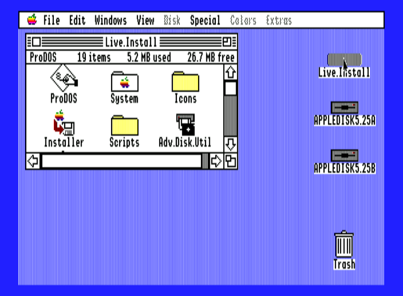
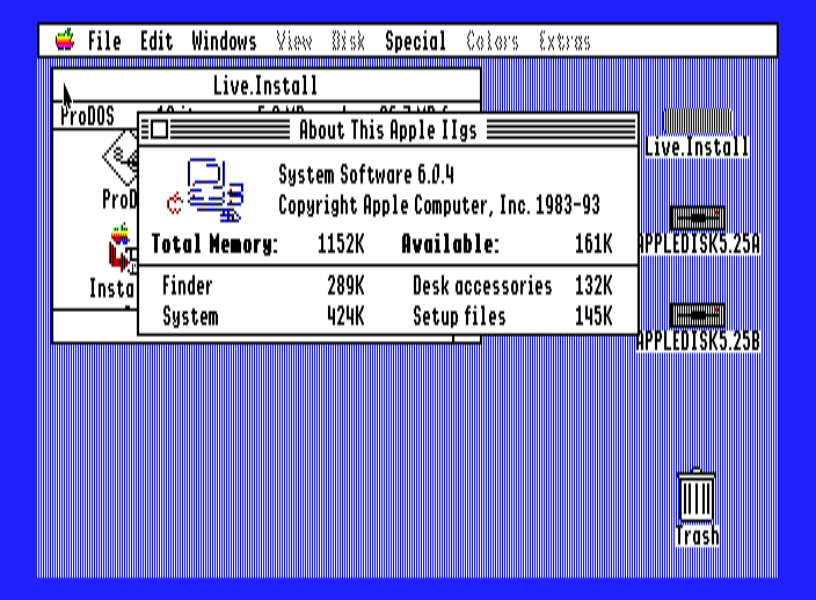
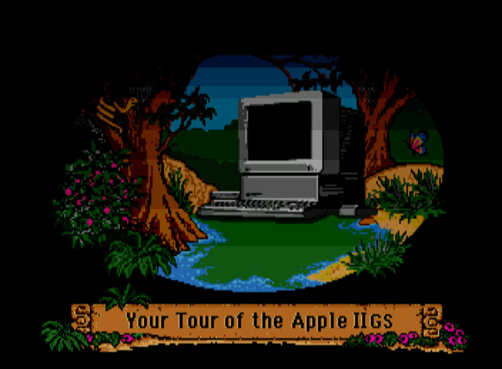
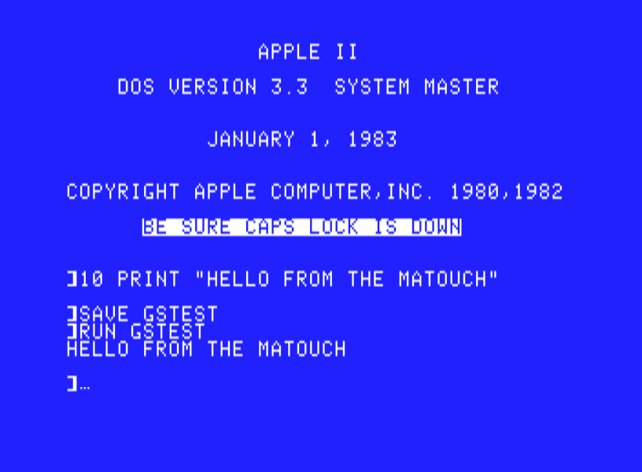
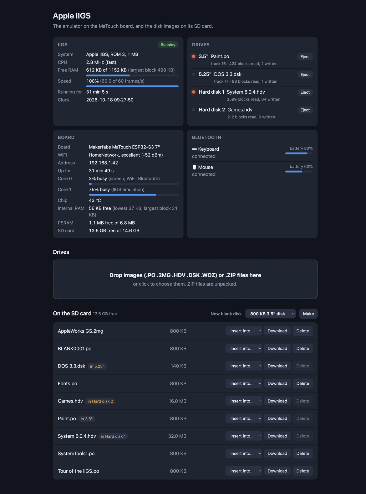
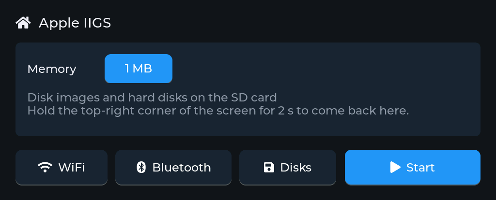
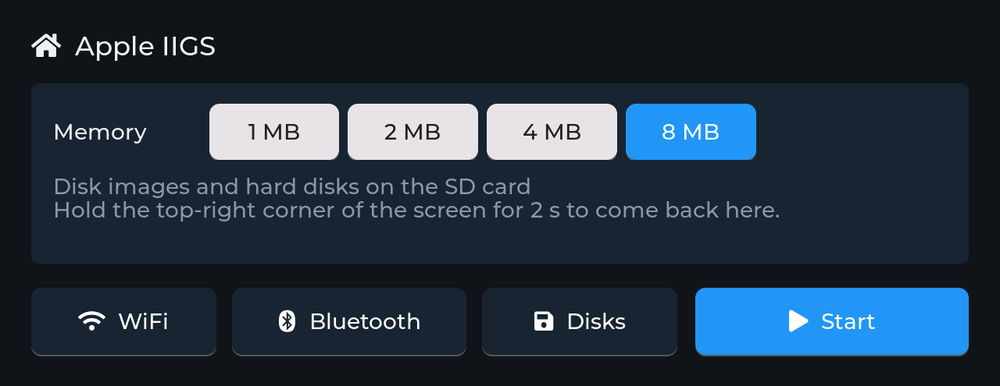
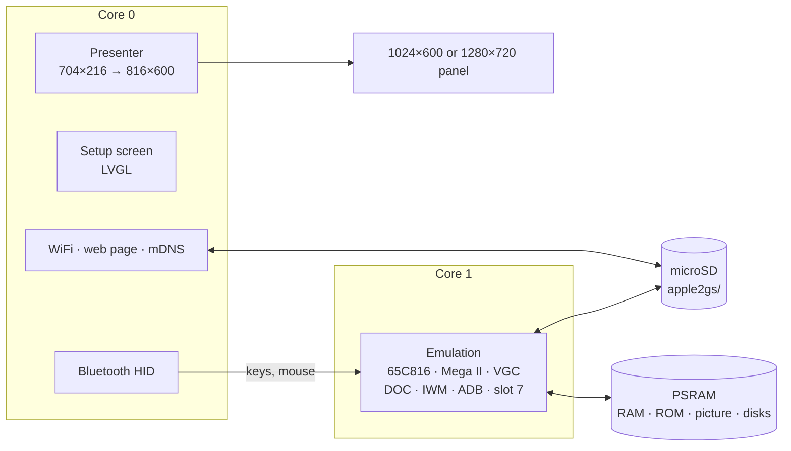

<h1 align="center">esp32gs</h1>

<p align="center">
  <b>An Apple IIGS on a 7-inch ESP32-S3 touch-screen board or an M5Stack Tab5.</b><br>
  ROM 3, GS/OS 6 from floppies or hard disks, Super Hi-Res and all the Apple II modes, Ensoniq sound, Bluetooth keyboard and mouse, the touch screen as the pointer.
</p>

<p align="center">
  
  
  
  
  
  
</p>

<p align="center">
  
  
  <br>
  
  
  <br>
  <sub>GS/OS 6.0.4 from a hard disk image on the MaTouch, and its About box with 1 MB;
  the Tour of the Apple IIGS on the Tab5; DOS 3.3 from the 5.25" drive, a program saved
  and run back. As on the panels, border included.</sub>
</p>

esp32gs turns the Makerfabs MaTouch ESP32-S3 Parallel TFT with Touch 7", or an
M5Stack Tab5, into an Apple IIGS. The picture, border included, fills the
panel's height; a Bluetooth keyboard and mouse work the IIGS, a finger on the
screen moves its pointer, and disk images come from the microSD card. A setup
screen on the touch panel, and a web page on your network, handle everything
else.

It's the sibling of [esp32ste](https://github.com/rlucencic/esp32ste) (Atari
STE), [esp32mac](https://github.com/rlucencic/esp32mac) (Macintosh Plus,
SE, Classic), [esp32cpc](https://github.com/rlucencic/esp32cpc) (Amstrad
CPC), [esp32zx](https://github.com/rlucencic/esp32zx) (ZX Spectrum),
[esp32cbm](https://github.com/rlucencic/esp32cbm) (Commodore 64 and 128),
[esp32xl](https://github.com/rlucencic/esp32xl) (Atari 800XL and 130XE) and
[esp32msx](https://github.com/rlucencic/esp32msx) (MSX1 and MSX2); all are built on the shared runtime
[esp32emu](https://github.com/rlucencic/esp32emu), which also holds the
65C816 core. The IIGS's chips around the CPU come from
[Clemens](https://github.com/samkusin/clemens_iigs), Samir Sinha's IIGS
emulator (MIT).

## Features

**The machine**
- **Apple IIGS, ROM 3**: 1 MB on the MaTouch (the IIGS's own); 1, 2, 4 or
  8 MB on the Tab5, chosen on the setup screen
- **65C816** at 2.8 or 1 MHz as the IIGS switches, emulation and native
  mode; checked against the 5 million SingleStepTests
- **Video**: Super Hi-Res 320 and 640 with a palette per line and fill
  mode, text in 40 and 80 columns with MouseText, lores, double lores, hires
  and double hires, mixed modes, the border colour
- **Sound**: the Ensoniq DOC's 32 oscillators and the Apple II speaker
- **ADB keyboard and mouse**, the clock and battery RAM (the control panel's
  settings are kept)

**Drives**
- **3.5"** (slot 5): 800 KB and 400 KB disks, `.po`, `.2mg`, `.woz`
- **5.25"** (slot 6): 140 KB disks, `.dsk`/`.do` (DOS order), `.po`, `.woz`
- **Two hard disks** (a card in slot 7): ProDOS block images of any size up
  to 32 MB, `.po`, `.hdv`, `.2mg`, read and written in place
- Writes go back into the image files (floppies a second after the drive's
  motor stops); `.woz` is read-only
- **New blank disks**: 800 KB, 140 KB, 16 or 32 MB, ready for GS/OS to
  initialise

**Around it**
- **Setup screen** before the IIGS starts, and any time while it runs (hold
  the top-right corner for 2 seconds): WiFi, Bluetooth pairing, the memory,
  the drives, reset
- **Bluetooth keyboard and mouse** (BLE HID): keys where Apple's keyboard
  has them; Alt is Option, the Windows or Command key is the open apple, F12
  is Reset
- **Touch**: the pointer goes where you touch, and a touch clicks (GS/OS and
  other desktop programs)
- **Web page** at `http://apple2gs.local`: drop disk images or `.ZIP` files
  onto it, put them into drives, eject, make blank disks, and watch the
  machine (with GS/OS's free memory), drives, board and Bluetooth devices
  live
- **Sound** on the board's speaker (on the Tab5 by default, on the MaTouch
  optional, `menuconfig`)

<p align="center">
  
</p>

## Hardware

| | Makerfabs MaTouch ESP32-S3 7" | M5Stack Tab5 |
|---|---|---|
| Chip | ESP32-S3-WROOM-1-N16R8: 16 MB flash, 8 MB octal PSRAM | ESP32-P4 (RISC-V, 360 MHz): 16 MB flash, 32 MB PSRAM; an ESP32-C6 for WiFi and Bluetooth |
| Screen | 7" 1024×600 RGB, GT911 capacitive touch | 5" 1280×720 MIPI-DSI, capacitive touch, held landscape |
| Storage | microSD card (FAT32 or exFAT) | microSD card (FAT32 or exFAT) |
| Input | BLE keyboard and mouse | BLE keyboard and mouse, or the Tab5 Keyboard |
| Sound | a speaker on the MAX98357A output (optional, `menuconfig`) | the built-in speaker (ES8388) |

The picture is 704×216: the 640×200 Super Hi-Res area with the border around
it (the Apple II modes' 560×192 in its middle). It's shown at 4:3, 816×600 on
the MaTouch and 979×720 on the Tab5, smoothly scaled.

## Getting started

### 1. What you need

- [ESP-IDF](https://github.com/espressif/esp-idf) v5.5 (developed with v5.5.4)
- [esp32emu](https://github.com/rlucencic/esp32emu), checked out next to this project (`../esp32emu`)
- The IIGS ROM 3 and the IIe video ROM in `roms/` (see [roms/README.md](roms/README.md))
- A microSD card, FAT32 or exFAT
- GS/OS: Apple's System 6 disk images are on the
  [Apple II Documentation Project](https://mirrors.apple2.org.za/Apple%20II%20Documentation%20Project/Software/Operating%20Systems/Apple%20IIGS%20System/Disk%20Images/)
  mirror; System 6.0.4's `Live.Install.po` is a ready 32 MB hard disk

### 2. Build and flash

```sh
git clone https://github.com/rlucencic/esp32emu.git     # the shared runtime, next to it
git clone https://github.com/rlucencic/esp32gs.git && cd esp32gs
idf.py build
idf.py -p /dev/cu.usbmodem… flash      # app and the ROM images

# or for the M5Stack Tab5 (its own build folder and settings):
idf.py -B build-tab5 -DIDF_TARGET=esp32p4 -DSDKCONFIG=build-tab5/sdkconfig build
idf.py -B build-tab5 -DIDF_TARGET=esp32p4 -DSDKCONFIG=build-tab5/sdkconfig -p /dev/cu.usbmodem… flash
```

Later updates only need `idf.py -p … app-flash`. Instead of flashing the
ROMs, you can also copy them into a `roms` folder on the SD card.

### 3. First start

1. The board starts on the **setup screen**. Tap **WiFi** to join your
   network: the web page becomes reachable.
2. Tap **Bluetooth** to pair a keyboard and a mouse.
3. On the Tab5, choose the **memory**. Tap **Start**: the IIGS shows its
   startup screen and looks for a disk to start from.
4. Open `http://apple2gs.local`, drop System 6.0.4's `Live.Install.po` onto
   the page, then **Insert into… → Hard disk 1**: the IIGS starts again and
   comes up in GS/OS, its Finder in under a minute.

<p align="center">
  
  
</p>

## Using it

| To | Do |
|---|---|
| Get back to the setup screen | Hold the top-right corner of the screen for 2 s |
| Start from a disk | Put it into a drive (the setup screen's Disks page, or the web page). The IIGS looks at the hard disks first, then 5.25", then 3.5"; **Reset** on the setup screen starts it again |
| Change the memory (Tab5) | On the setup screen; **Restart** applies it |
| Use a 3.5" disk under GS/OS | Insert it while GS/OS runs: its icon appears on the desktop. **Eject** in the Finder takes it out of the drive |
| Get to Applesoft BASIC | Control-Reset (Control-F12) while the IIGS looks for a disk |
| Open the control panel | Control-Command-Esc; its settings are kept in the board |
| Make a new disk | **New** on the drives page or on the web page, then initialise it in the Finder (Disk → Initialize) |
| Copy files from a computer | Drop them onto the web page (ZIP files are unpacked), or `curl -T disk.po http://apple2gs.local/disks/` |

Disk images live in the `apple2gs` folder on the SD card. The inserted ones
are remembered across restarts. The hard disks are the quickest way to work:
GS/OS boots from one in half a minute; a 3.5" floppy takes as long as the
real drive (and on the MaTouch, longer: see Limitations).

**Keyboard**: by position, as on Apple's keyboard (US). Return, Esc, Tab,
Delete (Backspace), Caps Lock, the cursor keys and the keypad as themselves;
Ctrl is Control, Alt is Option, the Windows or Command key is the open apple
(Command); F12 or Pause is Reset (Control-F12: Control-Reset;
Control-Command-F12 restarts).

**Mouse and touch**: a Bluetooth mouse moves the pointer as usual. A finger
on the screen puts the pointer there and clicks; tap twice quickly for a
double click. Touch works in GS/OS and programs that use the toolbox's
pointer.

## Configuration

`idf.py menuconfig` → **Emulator board**:

| Option | Default | |
|---|---|---|
| WiFi, setup screen | on | Time zone for the clock (POSIX TZ) |
| Start by itself | off | Countdown on the setup screen |
| Web page, network name | on, `apple2gs` | `http://<name>.local` |
| BLE keyboard and mouse | on | |
| Sound on the speaker | off (Tab5: on) | Volume; moves the MaTouch's console to the UART port |

## How it works



- **`components/apple2gs`**: the IIGS, platform independent: the glue between
  the 65C816 and Clemens's devices, the picture, the drives. It also builds
  on a desktop (`components/apple2gs/host`) for testing with scripted typing,
  keys and mouse, disks, screenshots, sound recording and CPU traces.
- **`components/apple2gs/clemens`**: the IIGS's memory map and chips from
  Clemens, with a few changes for the ESP32 (listed in `CLAUDE.md`).
- **`main`**: the IIGS on the board: memory, ROMs, settings, keyboard and
  mouse, drives and status.
- **[esp32emu](https://github.com/rlucencic/esp32emu)**: the board runtime
  and the 65C816 core.

The CPU reads and writes memory through tables of 256-byte pages built from
Clemens's own page maps, so ordinary memory goes straight to RAM and only I/O,
card ROM and shadowed writes take the slow path; when a soft switch remaps
memory, just the pages that changed are rebuilt. A frame is 262 scanlines;
the CPU runs one at a time at 2.8 or 1 MHz, then the chips catch up. At 1 MHz
the CPU keeps the Mega II's pace, stretched cycle included, in step with the
disk controller's bit cells: DOS 3.3 counts CPU cycles to write its nibbles.
Floppy images are turned into the bits the disk controller reads, a track at
a time, and changed tracks are turned back into sectors in the image file.

## Development

```sh
make -C components/apple2gs/host                                       # desktop build of the IIGS
GS_HD1=System604.hdv components/apple2gs/host/build/gs_host 3600 finder.ppm
GS_525=dos33.dsk GS_TEXT=1 components/apple2gs/host/build/gs_host 900   # DOS 3.3, text screen printed
make -C ../esp32emu/components/w65816/test                             # the 65C816 tests

python ../esp32emu/tools/emu_console.py /dev/cu.usbmodem… screenshot screen.png    # the IIGS's screen
python ../esp32emu/tools/emu_console.py /dev/cu.usbmodem… send 'T CATALOG\n'      # type on the IIGS
python ../esp32emu/tools/emu_console.py /dev/cu.usbmodem… profile build/esp32gs.elf  # where the time goes
curl http://apple2gs.local/api/status                                             # live status as JSON
```

`CLAUDE.md` has the details: architecture, timing, the drives, the changes to
Clemens, debugging options and the lessons learned along the way.

## Limitations

- **Speed on the MaTouch**: GS/OS's desktop runs at full speed (core 1 about
  three quarters busy), but the 3.5" drive's bit-by-bit emulation takes it
  to 77-97% while a floppy turns, and music on the Ensoniq beyond what it
  can keep up with. The Tab5 runs everything at full speed with time to
  spare, floppies included. Hard disk images are faster on the MaTouch.
- **1 MB on the MaTouch**: more doesn't fit next to the disk buffers and the
  board's own needs.
- Tried so far: ROM 3's startup and Applesoft, GS/OS 6.0.1 and 6.0.4 from
  floppies and hard disks, the Finder (windows, menus, About), a floppy
  inserted while GS/OS runs, DOS 3.3 (CATALOG, SAVE, RUN), the Tour of the
  Apple IIGS. **Games and most applications haven't been tried yet.**
- Not tried by hand yet: a Bluetooth keyboard and mouse on the IIGS, touch on
  the MaTouch's panel itself (driven remotely only). Sound was heard on the
  Tab5 and sounds right; some artefacts are being looked into.
- No serial ports, printer, AppleTalk or MIDI; one 3.5" and one 5.25" drive
  (no second ones); no nibble (`.nib`) images; `.woz` read-only.
- Touch follows the GS/OS pointer only: ProDOS 8 programs that read the mouse
  themselves need a Bluetooth mouse.

## Credits

- [Clemens](https://github.com/samkusin/clemens_iigs) by Samir Sinha (MIT):
  the IIGS's memory map, Mega II, VGC, ADB, clock, DOC, IWM, disk images and
  the slot 7 hard disk card
- Tom Harte's [SingleStepTests](https://github.com/SingleStepTests/65816) for
  the 65C816 core
- The [Apple II Documentation Project](https://mirrors.apple2.org.za/Apple%20II%20Documentation%20Project/)
  for the system software images
- [LVGL](https://lvgl.io) for the setup screen
- [ESP-IDF](https://github.com/espressif/esp-idf) and NimBLE

## Licence

[MIT](LICENSE). Clemens is MIT too (`components/apple2gs/clemens/LICENSE.txt`).
LVGL (MIT) and ESP-IDF (Apache 2.0) are fetched at build time and keep their
own licences.

Apple, Apple IIGS and GS/OS are trademarks of Apple Inc. The ROM images and
system software are not part of this repository.
